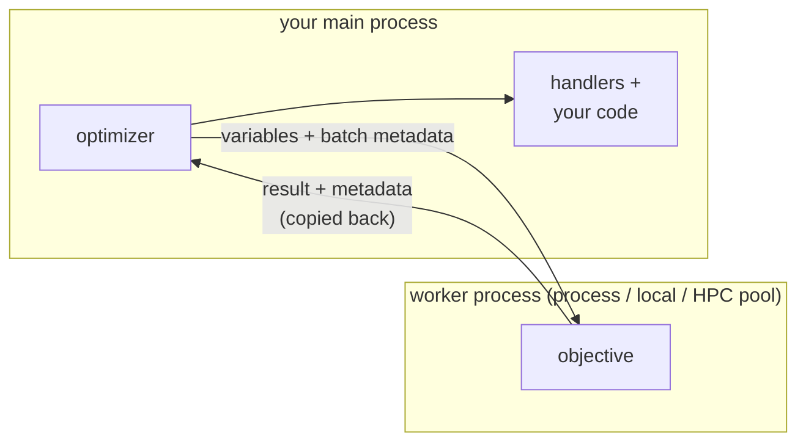

# Result Handlers

An [`optimize`][ropt.optimize] call returns only the best result. A
**handler** lets you collect or react to *every* result instead: it is an object
that observes an optimization and processes its results as they arrive — keeping
them, tabulating them, or invoking a callback.

Attach a handler to an optimization with the `handlers` argument:

```python
from ropt import HistoryHandler, optimize

history = HistoryHandler()

outcome = optimize(config, x0, objective, handlers=[history])
print(history.results)
```

Handlers that store results expose them through `handler["results"]` (and, for
`HistoryHandler`, the `history.results` shortcut).

## What handlers receive

Handlers receive [`EnOptEvent`][ropt.events.EnOptEvent] objects for the event
types they subscribe to. An event identifies what happened and carries the
configuration and any associated results. Some events, such as the start of
an optimization, contain no results.

`HistoryHandler`, `ResultsHandler` and `DataFrameHandler` subscribe to
`FINISHED_EVALUATION` events and process the
[`FunctionResults`][ropt.results.FunctionResults] and
[`GradientResults`][ropt.results.GradientResults] objects in the event's
`results` tuple. These are the same result classes used by result callbacks
and by the return value of `optimize`. Their fields are described in
[Working with Results](results.md).

## Built-in handlers

The handlers below are exported from `ropt`, ready to use as they are.

### `HistoryHandler`

[`HistoryHandler`][ropt.HistoryHandler] keeps *every* result it receives,
in order, as a tuple. Read it with `handler.results`, which is an empty tuple
until the first result arrives, or with `handler["results"]`, the raw stored
value, which is `None` until then.

### `ResultsHandler`

[`ResultsHandler`][ropt.ResultsHandler] keeps a single result, read via
`handler["results"]`:

- `what="best"` (default) keeps the result with the lowest weighted objective
  seen so far; `what="last"` keeps the most recent valid result.
- `constraint_tolerance` (optional) discards results that violate a constraint
  by more than the given tolerance.
- `filter` (optional) is a callable that receives each
  [`Results`][ropt.results.Results] and returns `True` to keep it or `False` to
  drop it.

The gradient computed at the result it keeps, if there is one, is read via
`handler["gradient"]`. A gradient usually reaches the handler in a later
evaluation than that result, and is attached to it only if both of these hold:

- [`GradientResults.uses`][ropt.results.GradientResults.uses] returns `True`
  for the result, meaning the gradient was constructed from its values;
- the gradient is at the same point as the result.

In general the first does not imply the second. The
[stochastic gradient](../optimizer_setup/gradients.md) that `ropt` currently
estimates is always at the point of the function evaluation it was constructed
from, so for this gradient the second test always passes. `handler["gradient"]`
is `None` while that gradient has not arrived, and stays `None` for a point
where no gradient was computed — the best point of an optimization often is one.


### `DataFrameHandler`

[`DataFrameHandler`][ropt.DataFrameHandler] collects results into named
DataFrames, using either `polars` (the default) or `pandas` as its engine; the
corresponding package must be installed. Define a table with
`add_table(name, table_type, columns)`, where `table_type` is
`"functions"` or `"gradients"` and `columns` maps result-field names (dotted
attribute syntax) to column titles. The field names are those of the result
objects, so `variables` and `scaled.variables` select different columns; see
[Working with Results](results.md). The runnable
[tables example](https://github.com/TNO-ropt/ropt/blob/main/examples/tables.py)
defines tables of both types for the ensemble Rosenbrock function, and is
explained [below](#example-tables-of-both-types).

```python
from ropt import DataFrameHandler

tables = DataFrameHandler()
tables.add_table(
    "summary",
    "functions",
    {
        "batch_id": "Batch",
        "functions.objectives": "Objective",
        "variables": "Variable",
    },
)
optimize(config, x0, objective, handlers=[tables])
df = tables["summary"]
```

Read one table with `tables["summary"]`, or all of them with `get_tables()`.
Columns appear in the order the specification lists them. A
field whose value is a vector or matrix expands to several columns; the extra
column levels come from the field's axis labels (or indices), joined to the
title with a separator (`,` by default, set with `sep=`). The labels come from
the [`names`](../optimizer_setup/configuration_sections.md#names) mapping: a length-2
`variables` gives `Variable,v0` and `Variable,v1` when the variables are named
`v0` and `v1`, and `Variable,0` and `Variable,1` when they are not. Because the
column names follow
[`results_to_pandas`](results.md#metadata-columns), both
result-level and per-realization metadata can be included and renamed.
The runnable [metadata example](https://github.com/TNO-ropt/ropt/blob/main/examples/metadata.py)
shows a per-realization array with a configured `names` entry and exports it
through `evaluations.metadata.residual`.

Tables are built with polars by default. Pass `engine="pandas"` to get pandas
DataFrames instead:

```python
tables = DataFrameHandler(engine="pandas")
```

The tables carry the same columns under the same titles. As explained in
[Exporting to polars](results.md#exporting-to-polars), polars
has no index, so the key columns (`batch_id`, `realization`, and the other axis
names) appear as ordinary leading columns rather than in the index; with pandas
they form the index instead. Both engines align fields of differing
granularity, broadcasting a per-batch field across the per-realization rows.

#### Available fields

The keys of the `columns` dict are taken from the two tables below. A
`"functions"` table reads the fields of
[`FunctionResults`][ropt.results.FunctionResults], a `"gradients"` table those
of [`GradientResults`][ropt.results.GradientResults]. See
[What each field holds](results.md#what-each-field-holds) for the meaning of
each field, and [Scaling of results](results.md#scaling-of-results) for the
fields under `scaled`, which hold the same values in the domain the optimizer
works in.

Each variable, objective and constraint gets a column of its own, titled with
its label from the [`names`](../optimizer_setup/configuration_sections.md#names)
section, or with its index if it has no label. Each realization and each
perturbation gets a row of its own. For example, this column dict:

```python
{
    "batch_id": "Batch",
    "realization": "Realization",
    "variables": "Variable",
    "evaluations.objectives": "Objective",
    "evaluations.constraints": "Constraint",
}
```

gives the following table for the problem in the
[example below](#example-tables-of-both-types), with two variables named `x` and
`y`, one unnamed objective, one constraint named `limit`, and five
realizations:

| Batch | Realization | Variable,x | Variable,y | Objective,0 | Constraint,limit |
| ----- | ----------- | ---------- | ---------- | ----------- | ---------------- |
| 0     | 0           | -1.0       | 1.5        | 30.057      | -7.371           |
| 0     | 1           | -1.0       | 1.5        | 27.263      | -8.067           |
| 0     | 2           | -1.0       | 1.5        | 30.887      | -10.147          |
| 0     | 3           | -1.0       | 1.5        | 28.286      | -8.735           |
| 0     | 4           | -1.0       | 1.5        | 28.571      | -9.656           |
| 2     | 0           | -2.0       | -2.0       | 3816.174    | -21.416          |

A value that is the same for all realizations, such as `variables`, is
repeated on each realization row. A gradient gets a column for each pair of
function and variable, for example `Objective gradient,0,x`. `batch_id`, `realization` and `perturbation`
are not read from the results: they identify the row, and appear only if they
are listed. `<key>` in the tables below stands for a key of a metadata dict.

A field that has no value in a result gives no columns, without an error. For
example, `functions.constraints` gives no columns if no nonlinear constraints
are configured, the realization weights give none without a
[realization filter](../optimizer_setup/realization_filters.md), and
`constraint_info.linear_lower` gives none without linear constraints. The
exception is `constraint_info` as a whole: it exists only if all lower or all
upper variable bounds are finite, or if linear or nonlinear constraints are
configured. Without it, a table that lists a `constraint_info` or
`scaled.constraint_info` entry raises a `ValueError`.

??? info "Available fields for function tables"

    | Field                                        | Content |
    | -------------------------------------------- | ------- |
    | `batch_id`                                   | Batch ID |
    | `realization`                                | Realization index |
    | `function_id`                                | Index of the evaluation within its batch |
    | `variables`                                  | Variable values |
    | `target_objective`                           | Weighted objective that the optimizer minimizes, in its own domain |
    | `functions.objectives`                       | Objective values, aggregated over the realizations |
    | `functions.constraints`                      | Nonlinear constraint values, aggregated over the realizations |
    | `evaluations.objectives`                     | Objective values of each realization |
    | `evaluations.constraints`                    | Nonlinear constraint values of each realization |
    | `evaluations.metadata.<key>`                 | Per-realization metadata |
    | `realizations.evaluated_realizations`        | `True` if the realization was evaluated |
    | `realizations.objective_weights`             | Objective weight of each realization |
    | `realizations.constraint_weights`            | Constraint weight of each realization |
    | `constraint_info.bound_lower`                | Variables minus their lower bounds |
    | `constraint_info.bound_upper`                | Variables minus their upper bounds |
    | `constraint_info.bound_violation`            | Violation of the variable bounds |
    | `constraint_info.linear_lower`               | Linear constraint values minus their lower bounds |
    | `constraint_info.linear_upper`               | Linear constraint values minus their upper bounds |
    | `constraint_info.linear_violation`           | Violation of the linear constraints |
    | `constraint_info.nonlinear_lower`            | Nonlinear constraint values minus their lower bounds |
    | `constraint_info.nonlinear_upper`            | Nonlinear constraint values minus their upper bounds |
    | `constraint_info.nonlinear_violation`        | Violation of the nonlinear constraints |
    | `metadata.<key>`                             | Metadata of the optimization |
    | `scaled.variables`                           | `variables`, scaled |
    | `scaled.functions.objectives`                | `functions.objectives`, scaled |
    | `scaled.functions.constraints`               | `functions.constraints`, scaled |
    | `scaled.constraint_info.bound_lower`         | `constraint_info.bound_lower`, scaled |
    | `scaled.constraint_info.bound_upper`         | `constraint_info.bound_upper`, scaled |
    | `scaled.constraint_info.bound_violation`     | `constraint_info.bound_violation`, scaled |
    | `scaled.constraint_info.linear_lower`        | `constraint_info.linear_lower`, scaled |
    | `scaled.constraint_info.linear_upper`        | `constraint_info.linear_upper`, scaled |
    | `scaled.constraint_info.linear_violation`    | `constraint_info.linear_violation`, scaled |
    | `scaled.constraint_info.nonlinear_lower`     | `constraint_info.nonlinear_lower`, scaled |
    | `scaled.constraint_info.nonlinear_upper`     | `constraint_info.nonlinear_upper`, scaled |
    | `scaled.constraint_info.nonlinear_violation` | `constraint_info.nonlinear_violation`, scaled |

??? info "Available fields for gradient tables"

    | Field                                 | Content |
    | ------------------------------------- | ------- |
    | `batch_id`                            | Batch ID |
    | `realization`                         | Realization index |
    | `perturbation`                        | Perturbation index |
    | `variables`                           | Variable values that were perturbed |
    | `target_gradient`                     | Gradient that the optimizer descends, in its own domain |
    | `gradients.objectives`                | Gradient of each objective |
    | `gradients.constraints`               | Gradient of each nonlinear constraint |
    | `perturbed_variables`                 | Perturbed variable values |
    | `evaluations.perturbed_objectives`    | Objective values of each perturbation |
    | `evaluations.perturbed_constraints`   | Nonlinear constraint values of each perturbation |
    | `evaluations.metadata.<key>`          | Per-perturbation metadata |
    | `realizations.evaluated_realizations` | `True` if the realization was evaluated |
    | `realizations.objective_weights`      | Objective weight of each realization |
    | `realizations.constraint_weights`     | Constraint weight of each realization |
    | `metadata.<key>`                      | Metadata of the optimization |
    | `scaled.variables`                    | `variables`, scaled |
    | `scaled.perturbed_variables`          | `perturbed_variables`, scaled |
    | `scaled.gradients.objectives`         | `gradients.objectives`, scaled |
    | `scaled.gradients.constraints`        | `gradients.constraints`, scaled |

The `names` and `source_key` attributes of a result are not fields of a table:
an entry of `names` repeats the labels that are already part of the column
titles, and `source_key` gives two rows per result.

#### Column dicts to copy

The two dicts below list every field of the tables above, with a column title
for each. Copy one, delete the entries you do not need, and pass it to
`add_table`. Both dicts list fields at the realization level, so a table built
from the complete dict has one row per realization, or per realization and
perturbation. Delete the `constraint_info` and `scaled.constraint_info` entries
for a problem without bounds or constraints.

??? example "Column dictionary for function tables"

    ```python
    FUNCTION_COLUMNS = {
        "batch_id": "Batch",
        "realization": "Realization",
        "function_id": "Function ID",
        "variables": "Variable",
        "target_objective": "Target objective",
        "functions.objectives": "Objective",
        "functions.constraints": "Constraint",
        "evaluations.objectives": "Realization objective",
        "evaluations.constraints": "Realization constraint",
        "realizations.evaluated_realizations": "Evaluated",
        "realizations.objective_weights": "Objective weight",
        "realizations.constraint_weights": "Constraint weight",
        "constraint_info.bound_lower": "Bound lower difference",
        "constraint_info.bound_upper": "Bound upper difference",
        "constraint_info.bound_violation": "Bound violation",
        "constraint_info.linear_lower": "Linear lower difference",
        "constraint_info.linear_upper": "Linear upper difference",
        "constraint_info.linear_violation": "Linear violation",
        "constraint_info.nonlinear_lower": "Nonlinear lower difference",
        "constraint_info.nonlinear_upper": "Nonlinear upper difference",
        "constraint_info.nonlinear_violation": "Nonlinear violation",
        "scaled.variables": "Scaled variable",
        "scaled.functions.objectives": "Scaled objective",
        "scaled.functions.constraints": "Scaled constraint",
        "scaled.constraint_info.bound_lower": "Scaled bound lower difference",
        "scaled.constraint_info.bound_upper": "Scaled bound upper difference",
        "scaled.constraint_info.bound_violation": "Scaled bound violation",
        "scaled.constraint_info.linear_lower": "Scaled linear lower difference",
        "scaled.constraint_info.linear_upper": "Scaled linear upper difference",
        "scaled.constraint_info.linear_violation": "Scaled linear violation",
        "scaled.constraint_info.nonlinear_lower": "Scaled nonlinear lower difference",
        "scaled.constraint_info.nonlinear_upper": "Scaled nonlinear upper difference",
        "scaled.constraint_info.nonlinear_violation": "Scaled nonlinear violation",
        # "metadata.<key>": "<title>",
        # "evaluations.metadata.<key>": "<title>",
    }
    ```

??? example "Column dictionary for gradient tables"

    ```python
    GRADIENT_COLUMNS = {
        "batch_id": "Batch",
        "realization": "Realization",
        "perturbation": "Perturbation",
        "variables": "Variable",
        "target_gradient": "Target gradient",
        "gradients.objectives": "Objective gradient",
        "gradients.constraints": "Constraint gradient",
        "perturbed_variables": "Perturbed variable",
        "evaluations.perturbed_objectives": "Perturbed objective",
        "evaluations.perturbed_constraints": "Perturbed constraint",
        "realizations.evaluated_realizations": "Evaluated",
        "realizations.objective_weights": "Objective weight",
        "realizations.constraint_weights": "Constraint weight",
        "scaled.variables": "Scaled variable",
        "scaled.perturbed_variables": "Scaled perturbed variable",
        "scaled.gradients.objectives": "Scaled objective gradient",
        "scaled.gradients.constraints": "Scaled constraint gradient",
        # "metadata.<key>": "<title>",
        # "evaluations.metadata.<key>": "<title>",
    }
    ```

#### Example: tables of both types

The [tables example](https://github.com/TNO-ropt/ropt/blob/main/examples/tables.py)
optimizes the ensemble Rosenbrock function with variable bounds and a nonlinear
constraint. The `names` section labels the variables and the constraint, and
these labels are used in the column titles:

```python
--8<-- "examples/tables.py:config"
```

Each table is defined by its own column dict, a subset of the dicts above.
`FUNCTIONS` keeps one row per result; `EVALUATIONS` lists per-realization
fields and keeps one row per realization. `PERTURBATIONS` has one row per
realization and perturbation:

```python
--8<-- "examples/tables.py:columns"
```

One handler holds all four tables. The second argument of `add_table` selects
the results that fill the table:

```python
--8<-- "examples/tables.py:tables"
```

The handler is passed to `optimize`, and the tables are read after it returns:

```python
--8<-- "examples/tables.py:run"
```

The `functions` table has the columns `Batch`, `Variable,x`, `Variable,y`,
`Target objective`, `Objective,0`, `Constraint,limit` and `Violation,limit`. The
objective is not named in `names`, so its column uses the index `0`.

Other methods:

- `add_column(table, name, title)` adds one column to an existing table.
- `set_callback(fn)` calls `fn(output_dir)` whenever the tables are updated,
  where `output_dir` is the optimization's configured
  [`output_dir`](../optimizer_setup/configuration_sections.md#optimizer) (`None` if it is
  not set).

!!! tip "Write the tables to a file as they update"
    `set_callback` fires on every update, so it is a convenient hook for saving
    the tables — to watch progress live or to write a final report. Pandas'
    `to_string()` gives aligned, human-readable columns with no extra
    dependencies; use `to_csv()` for machine-readable data:

    ```python
    def dump(output_dir):
        path = Path("progress.txt") if output_dir is None else output_dir / "progress.txt"
        with path.open("w") as fh:
            for name, df in tables.get_tables().items():
                fh.write(f"# {name}\n{df.to_string()}\n\n")

    tables.set_callback(dump)
    optimize(config, x0, objective, handlers=[tables])
    ```

    Because this writes to disk on every update, the optimization that emitted
    the result waits for the write to finish.

### `CallbackHandler`

[`CallbackHandler`][ropt.CallbackHandler] forwards selected events to a
function. Usually, `result_callback=` is sufficient for reporting results
or stopping an optimization when a criterion is met. Use `CallbackHandler`
when the function needs the event itself, including notifications that do
not carry results. It also provides a way to
[share a callback with a lock](#sharing-a-handler-across-concurrent-runs).

```python
from ropt import CallbackHandler, optimize
from ropt.enums import EnOptEventType
from ropt.events import EnOptEvent

def report_finished(event: EnOptEvent) -> None:
    print("Optimization finished:", event.event_type)

handler = CallbackHandler(
    event_types={EnOptEventType.FINISHED_OPTIMIZER},
    callback=report_finished,
)
outcome = optimize(config, x0, objective, handlers=[handler])
```

Unlike a result callback, this function receives an `EnOptEvent` and its return
value is ignored. Where the event provides a `stop` callable, call
`event.stop()` to request stopping the optimization. To process evaluation
results, subscribe to `FINISHED_EVALUATION` and iterate over `event.results`.

#### Updating evaluation metadata

During `START_EVALUATION`, any handler can read and modify
[`event.metadata`][ropt.events.EnOptEvent]
to pass values to the upcoming batch, either by modifying the dictionary in
place or by assigning a new dictionary to `event.metadata`. See
[Passing values to evaluations from event handlers](../running/running.md#passing-values-to-evaluations-from-event-handlers)
for a runnable example.

- The run takes a deep copy of its initial `metadata=` values. Before each
  `START_EVALUATION`, it resets the batch metadata to an independent copy of
  those defaults. The dictionary is empty if no defaults were supplied.
- Handlers receive the same dictionary in their listed order. Changes are
  visible immediately to the current handler and to later handlers. Ordinary
  dictionary operations apply, including item assignment, `update`, deletion,
  and `clear`.
- Edits apply only to the current batch. Added keys disappear on the next
  batch, while replaced or deleted defaults are restored. Runs have
  independent metadata even when sharing a handler.
- After all start handlers return, `ropt` deep-copies the effective metadata
  for the evaluation contexts and result recording. Later edits through a
  retained event, dictionary, or nested value have no effect on that batch.
  Values must support deep copying; those sent to separate worker processes
  must also be serializable.
- For all other event types, `event.metadata` is an empty dictionary, and
  changes to it are ignored. The metadata of a finished batch is available
  on each result's `metadata` field.

`START_EVALUATION` is emitted once per batch, not before each realization. It
is emitted before the evaluation-function calls needed for a batch of function
evaluations, gradient evaluations, or both. When initial results are supplied
as [`f0` or `g0`](../running/initial_values.md), `START_EVALUATION` handlers
still run for the initial batch, even if those results cover every row and no evaluation-function
calls are needed. The caller is responsible for keeping the supplied results
consistent with the inputs used by any remaining evaluations.

!!! note "Concurrent optimizations and `START_EVALUATION` handlers"
    A handler shared by optimizations running concurrently runs its callback
    for one optimization at a time, because it
    [holds its lock](#sharing-a-handler-across-concurrent-runs) while
    processing each event. A slow `START_EVALUATION` callback therefore delays
    the batches of all optimizations that share it. If the callback is
    thread-safe, create a separate `CallbackHandler` with the same callback for
    each optimization; the calls can then overlap. If it is not thread-safe,
    share one handler, or protect its state with a
    [`threading.Lock`][threading.Lock].

## Sharing a handler across optimizations { #sharing-a-handler-across-concurrent-runs }

Reuse a handler across sequential optimizations to collect their results
in one place:

```python
history = HistoryHandler()
for x0 in start_points:
    optimize(config, x0, objective, handlers=[history])
print(history.results)
```

The same handler can also be shared by optimizations running concurrently
on threads. Pass the **same handler object** to each optimization:

```python
from functools import partial

from ropt import HistoryHandler, optimize, run, session

history = HistoryHandler()
with session() as s:
    pool = s.thread_pool(workers=4)
    optimizations = [
        partial(optimize, config, x0, objective, pool=pool, handlers=[history])
        for x0 in start_points
    ]
    run(optimizations, pool=s.thread_pool(workers=len(start_points)))

print(history.results)
```

A handler's [`handle_event`][ropt.EventHandler.handle_event] holds its lock
while processing each event. A second optimization waits for the first to
finish, so no additional lock is needed merely because they share the
handler. Slow work in the handler delays every optimization using it.

The [result callback](../running/running.md#reporting-progress) is implemented
by a handler created separately for each optimization. Passing the same
function as `result_callback=` therefore does not share a lock: the function
can be called concurrently. If it updates shared data, provide synchronization
yourself or use **one shared [`CallbackHandler`](#callbackhandler)** instead.
Its lock covers the whole callback invocation. Creating a separate
`CallbackHandler` for each optimization does not provide a shared lock.

The results arrive interleaved, in an order that depends on which
optimization reaches the handler first. Use `batch_id` or a `metadata` field
set per optimization to identify them, rather than their arrival order.

[examples/handlers.py](https://github.com/TNO-ropt/ropt/blob/main/examples/handlers.py)
feeds two handlers from the same set of concurrent optimizations:

```python
--8<-- "examples/handlers.py:shared"
```

!!! warning "Do not start an optimization from inside a handler that it can reach"
    A handler holds its lock while processing an event. If it starts an
    optimization that uses the same handler, that optimization tries to
    acquire the lock again. On the same thread, this raises
    [`WorkflowError`][ropt.exceptions.WorkflowError]. On another thread, it
    waits for the lock while the first thread waits for the optimization,
    causing a deadlock. Two handlers can cause the same problem if each starts
    an optimization using the other. Give inner optimizations their own handlers.

Two handlers that write to the same external state each have their own lock,
so they can still run at the same time. Use a shared
[`threading.Lock`][threading.Lock] inside both `_handle_event` implementations
if those operations must not overlap.

## Writing your own handler

The built-in handlers above, and the result callback, cover the results an
optimization produces. A handler of your own is for everything else: reacting to
the start or the end of an optimization, writing results out in a format of your
own, or keeping a summary that none of the built-ins keeps.

Subclass [`EventHandler`][ropt.EventHandler] and implement two members:

- `event_types` — the [`EnOptEventType`][ropt.enums.EnOptEventType] values this
  handler wants to receive. An event of any other type never reaches it.
- `_handle_event(event)` — called with each
  [`EnOptEvent`][ropt.events.EnOptEvent] of those types.

```python
from ropt.enums import EnOptEventType
from ropt.events import EnOptEvent
from ropt import EventHandler, optimize


class CountEvaluations(EventHandler):
    def __init__(self):
        super().__init__()
        self.count = 0

    @property
    def event_types(self):
        return {EnOptEventType.FINISHED_EVALUATION}

    def _handle_event(self, event: EnOptEvent) -> None:
        self.count += len(event.results)


counter = CountEvaluations()
optimize(config, x0, objective, handlers=[counter])
print(counter.count)
```

An [`EnOptEvent`][ropt.events.EnOptEvent] carries the `event_type` that
triggered it and a `results` tuple, which holds the
[`Results`][ropt.results.Results] objects of a `FINISHED_EVALUATION` and is
empty for the other types. Calling `event.stop()` ends the optimization that
emitted the event at the next evaluation boundary, with exit code `STOPPED`.
The types an
optimization emits are:

| Event type            | When it is emitted                                          |
| --------------------- | ----------------------------------------------------------- |
| `START_OPTIMIZER`     | Just before the optimization algorithm begins iterating.    |
| `FINISHED_OPTIMIZER`  | After it finishes, whether it converged, stopped or failed. |
| `START_EVALUATION`    | Before a batch of function or gradient evaluations.         |
| `FINISHED_EVALUATION` | After that batch completes; carries its results.            |

An [`evaluate`][ropt.evaluate] or
[`evaluate_batch`][ropt.evaluate_batch] call has no optimizer, and emits
`START_ENSEMBLE_EVALUATOR` and `FINISHED_ENSEMBLE_EVALUATOR` around its single
batch instead of the optimizer pair.

Handlers are called on the thread that emits the event, in the order the
`handlers` argument lists them, and the optimization or evaluation waits until
every handler for that event has returned. A handler that blocks therefore holds
up the optimization or evaluation that fed it, and any other one waiting on the
same handler's lock. Keep a handler shared by
concurrent optimizations cheap; if one must do heavy I/O, buffer in memory and
write once the optimizations have finished.

!!! note "A handler failure ends the optimization"
    An exception raised by a handler is fatal. It is raised on the stack of the
    optimization or evaluation that emitted the event, so it propagates as a single exception, and the handlers listed after
    it do not see that event.

!!! note "Read a handler's state after the calls feeding it have finished"
    State kept on a handler, or stored with `handler[key]`, is deliberately not
    bound to a thread, so it can be read from anywhere once the optimizations
    and evaluations feeding it have returned. That return is what makes the latest values visible. Reading
    it while one is still feeding the handler on another thread gives a valid
    but possibly stale value. To follow an optimization as it goes, use the
    handler's own `_handle_event`, or a result callback, rather than polling
    another handler's state.

## Handlers and separate processes

With a thread pool (or with no pool) your objective and your handlers run
in the **same process** and share memory: a handler can see anything the
objective left behind — a global it set, a list it appended to, an object it
mutated.

A process or HPC pool breaks that. The objective runs in a **separate
worker process**, while the optimizer, your handlers, and the rest of your
program stay
in the **main process**. They cannot share memory. The objective's *only* way to
send information back is through what it **returns** — the objective and
constraint values, and the result's `metadata` — all copied back to the main
process:



??? info "How data is copied between processes"
    To move work and results between processes, `ropt` **serializes** them —
    turns the objects into bytes and rebuilds them on the other side. Both a
    process pool and an HPC pool use Python's standard `pickle` by default, so
    an objective defined at module level works as is; a lambda, a closure, or a
    notebook-defined objective needs the optional `cloudpickle` extra. Most
    functions and data serialize fine, but things like open files, locks, or
    database connections may not.

    With a process pool the bytes travel over an in-machine channel. With an
    HPC pool they are written as **files on a shared filesystem** that the
    cluster nodes read, so it needs such a filesystem (its `workdir`).

    Serialization is only the mechanism `ropt` uses today; the essential
    requirement is that the data can be *moved from one process to the other*,
    so a future version could use a different transport — for example one that
    works over a network.

Handlers see those returned results and nothing else. Anything the objective did
only in memory — setting a module global, appending to a shared list, updating an
object — happened **inside the worker** and is discarded when it finishes; your
handlers and your main program never see it.

So to get extra information from an evaluation to a handler (or to a later part
of your program), **return it** instead of stashing it in shared state: attach it
to the result's `metadata` (see [Attaching metadata](../running/running.md#attaching-metadata)), which
is returned with the result. Relying on shared state happens to work on a
thread pool, but breaks the moment you switch to a process pool;
returning the data works everywhere.
