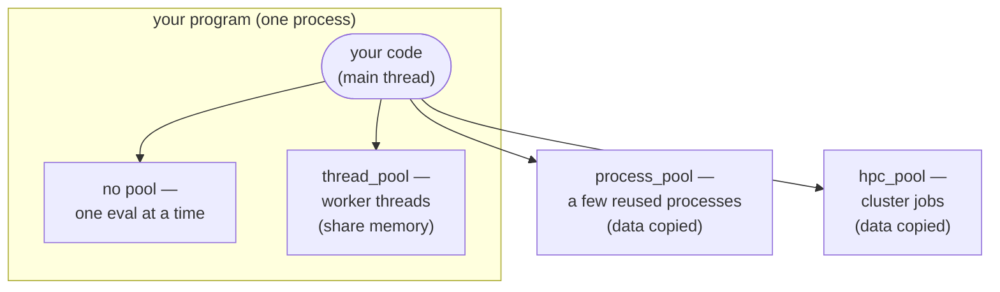

# Evaluating in Parallel

An evaluation **pool** runs evaluations within one optimization, or functions
passed to [`run`][ropt.run], in parallel. This page compares pool types and
explains how many workers they can use. For opening and closing the session
that owns a pool, see [Sessions](sessions.md).

## Running in parallel

Pass a pool from an open session to [`optimize`][ropt.optimize]:

```python
from ropt import optimize, session

with session() as s:
    result = optimize(config, x0, objective, pool=s.thread_pool(workers=8))
```

The runnable script for this section is
[examples/parallel.py](https://github.com/TNO-ropt/ropt/blob/main/examples/parallel.py).

The available pools are:

- [`thread_pool`](#thread-pool): runs evaluations on threads in your process.
- [`process_pool`](#process-pool): runs evaluations in reused worker processes.
- [`hpc_pool`](#running-on-an-hpc-cluster): submits each evaluation as a job to
  an HPC cluster.

Where an evaluation runs depends on the type of pool used:



Threads stay **inside** your program and share its memory, so any Python
function works and nothing is copied. The other two run the work **outside**
it, so the objective and its data are copied there.

The optimizer itself, the pool object and your handlers remain in the process
that opened the session and started the optimization, whichever pool you
choose. Throughout this page, **your program** means that process.

??? info "New to threads and processes?"
    A **process** is a running program with its own private memory. A **thread**
    is a worker inside a process, and all threads in a process share that memory.
    Threads are cheap and share data for free, but Python runs only one thread's
    *Python* code at a time. Work that **waits** — for a file, a network reply,
    an external tool — overlaps freely, because a waiting thread is not running
    Python code; and so does work a library performs outside Python, as `numpy`
    does while it works on an array. What is stuck one-at-a-time is arithmetic
    written in Python itself. Separate **processes** each have their own
    interpreter and always run truly in parallel, but they do not share memory,
    so data has to be copied between them, and starting one takes noticeably
    longer than starting a thread. A process also need not be on this machine:
    an HPC pool runs each evaluation as a job on a cluster, which is the
    same arrangement spread over more machines.

### How many workers?

Within an optimization, evaluations in the same batch can run in parallel.
The next batch cannot start until the current one finishes. Multiple
optimizations can run at the same time, each with its own active batch.

So the number of workers that can be kept busy is roughly

```
batch size  ×  optimizations running at once
```

capped by what the machine or the queue will actually give you. Beyond that
figure the extra workers have nothing to do and sit idle.

Batch size follows from the problem, not from a setting: it is how many
evaluations the optimizer requests at once. For a gradient-based optimization
over an ensemble that is one per realization, plus their perturbations on the
batches where a gradient is estimated. With one optimization, only one batch
is active at a time. If you [run several optimizations together](multiple_runs.md),
each can have an active batch; the pool passed to `run` limits how many
optimizations can run at once.

Each evaluation in a batch is sent to a worker as a separate job. Up to
`workers` jobs can run at once with a pool; the rest wait until a worker is
available. An optimization started without a pool calls the evaluation
function itself, one evaluation at a time.

You can keep several pools open at once and choose per optimization:

```python
with session() as s:
    fast = s.thread_pool(workers=8)
    heavy = s.process_pool(workers=4)
    cheap = optimize(config, x0, objective, pool=fast)
    costly = optimize(config, x0, expensive_objective, pool=heavy)
```

!!! note "Pools inside an evaluation"
    An evaluation function may start an optimization of its own, but build its
    pool **once**, in the calling code, and pass it to every evaluation. Building one
    per evaluation gives each a budget separate from every other: ten evaluations
    each building a ten-worker pool put a hundred workers on the machine,
    where one shared pool puts ten. Which pool it may be is a separate
    question, and the rules are in
    [Pools inside an evaluation](#pools-inside-an-evaluation) below.

### Evaluating on threads { #thread-pool }

A [`thread_pool`][ropt.Session.thread_pool] runs the evaluations on
background threads inside your own process. Nothing is copied, so any Python
function works as the objective and it can freely use the data around it:

```python
with session() as s:
    result = optimize(config, x0, objective, pool=s.thread_pool(workers=4))
```

Use it when each evaluation spends most of its time **waiting** — starting an
external program, reading a file, calling a network service. While one waits,
the others run.

Threads share one Python interpreter, so arithmetic written in Python itself
does not get faster on more threads. Array libraries are a different matter:
`numpy` and its kin do their work outside Python and let the other threads run
meanwhile. "My objective computes" is therefore not on its own a reason to reach
past this pool — see [Which pool should I use?](#which-pool).

### Evaluating in worker processes { #process-pool }

A [`process_pool`][ropt.Session.process_pool] runs evaluations in separate
processes, reused across the optimization. Each has its own interpreter, so
heavy Python code can run in parallel:

```python
with session() as s:
    result = optimize(config, x0, objective, pool=s.process_pool(workers=4))
```

This pool applies when the evaluation runs heavy **Python code**, or when each
worker needs a separate copy of state kept by a library used in the evaluation
function. An objective that mostly runs an external program gains nothing here
that a thread pool would not have given more cheaply.

!!! note
    "Isolating the optimizer is different from isolating evaluations" A
    process pool runs the **evaluation function** in worker processes; the
    optimization backend still runs in the process that called `optimize`. If
    the backend cannot safely run alongside other optimizations because its
    library keeps process-wide state, prefix its method with `external/`. This
    runs the **backend** in a separate process while evaluations still use the
    pool passed to `optimize`. Starting a process and transferring evaluation
    requests and results between processes adds overhead. The built-in SciPy
    backend does not need this isolation, but some backend plugins may. See
    [Running the method in a separate
    process](../optimizer_setup/optimizer.md#external-backend) for the
    configuration and constraints, and [Running Multiple
    Optimizations](multiple_runs.md) for concurrent runs.

The objective and its data are **copied** to the workers, so they must be
serializable. An objective defined at module level — or in the script you ran,
which each worker re-imports — works as is; a lambda, a closure, or a
function defined in a notebook cell needs the `cloudpickle` extra (see
[Installation](../getting_started/installation.md#optional-extras)). Results can
only come **back** through the return value; see
[Handlers and separate processes](../results/handlers.md#handlers-and-separate-processes).

### Running on an HPC cluster

An [`hpc_pool`][ropt.Session.hpc_pool] submits each evaluation as a job to an
HPC queue through the [`pysqa`](https://pysqa.readthedocs.io/) package; it needs
the `ropt[hpc]` extra. `workdir` is required and must be an existing absolute
directory on a filesystem the compute nodes share. A job is a fresh command, so
the evaluation function must live in a module the job can import, which means a
module installed on the compute nodes, or the `ropt[cloudpickle]` extra. With no
further arguments it uses the default cluster and queue from the `pysqa`
configuration of your `ropt` installation:

```python
with session() as s:
    pool = s.hpc_pool(workers=10, workdir="/scratch/my-run")
    result = optimize(config, x0, objective, pool=pool)
```

The runnable script is
[examples/hpc.py](https://github.com/TNO-ropt/ropt/blob/main/examples/hpc.py).
Pass it `--queue local` and it runs the identical optimization on
[the local queue](#local-jobs), so the example works with or without a cluster.

A job is nothing more than a submission script with your evaluation command in
it, and there are **two mutually exclusive ways** to say what that script should
be: a `pysqa` configuration, or a `template` you write yourself. Both of those,
and the resources a job asks for, are set out in
[Configuring an HPC pool](#configuring-an-hpc-pool) at the end of this page.

#### The local queue { #local-jobs }

The queue `"local"` runs each job as a process on this machine instead of on
another node. It needs neither the `ropt[hpc]` extra nor a cluster
configuration, so an objective can be tested on it before it is run on a
cluster:

```python
pool = s.hpc_pool(workers=4, queue="local", workdir="/scratch/my-run")
```

The cluster settings `cores`, `memory_max`, `run_time_max`, `submit_options`
and `query_retries` are ignored, and a `template` or a `scheduler` raises a
`ValueError`. If a cluster in the `pysqa` configuration defines a queue named
`local`, `queue="local"` without a `cluster` raises an
[`ExecutionError`][ropt.exceptions.ExecutionError]; pass `cluster` to submit to
that queue.

### Which pool should I use? { #which-pool }

One question rules choices *out*, and it is the only one you can answer by
reading your own code rather than by measuring:

!!! question "Does your objective read or write anything outside its arguments and its return value?"

    Global variables, a cache, a logger, an open file or database handle, an
    event handler, a counter it increments — anything at all that outlives one
    call.

    - **No.** Every pool works. Choose on speed alone, and you can swap
      between them freely later.
    - **Yes.** Stay with threads, or with no pool at all: either way the
      objective runs in your program, where it sees the same memory. A process or
      HPC pool runs the objective somewhere else, on a *copy* of
      everything it touched, so a write goes to that copy and a read sees
      whatever the copy was made from. No error is raised; the numbers come out
      wrong.

Once that is settled, the choice is about speed, and about what
[stopping an optimization](#stopping-a-run) can do:

| Pool | Where evaluations run | Data | Speeds up heavy Python? | Use when |
| --- | --- | --- | --- | --- |
| none | your program, one at a time | shared | no | evaluations are fast |
| `thread_pool` | background threads, one process | shared | no — one interpreter | each evaluation mostly **waits** (external tool, I/O), or spends its time in `numpy` |
| `process_pool` | a few reused processes | copied | yes | each evaluation runs heavy **Python code**, or needs a process of its own |
| `hpc_pool` | jobs on a cluster | copied | yes | each evaluation is a big **cluster job** |

??? tip "How to decide, without guessing"
    There is no reliable rule for whether threads will scale on a given
    objective. "I use `numpy`" says almost nothing: whether the GIL is released
    depends on the operation, the dtype and the array size, and a real objective
    is a mixture whose Python-level share is invisible to the person who wrote
    it.

    Switching to a thread pool costs one argument, and if threads do not scale
    on your objective the result is no speedup rather than a broken
    optimization.
    Switching to processes costs a serializable objective and a process start
    per worker. So try threads first:

    1. Start with a thread pool. Time `workers=1` against `workers=4` on a
       shortened optimization.
    2. If it scales, you are done, and you never needed to know what the GIL was
       doing.
    3. If it does not, set `OMP_NUM_THREADS=1` (see below) and time it again.
    4. Only then move to processes.

    Directional guidance is fine as orientation — waiting on an external program
    almost always scales, arithmetic written in Python never does, array-heavy
    work depends — but treat it as a place to start, and decide on the timings.

??? tip "If more workers makes it *slower*"
    `numpy`, `scipy` and similar are already multi-threaded underneath, through
    a BLAS library that by default takes **every core on the machine**. Run four
    evaluations at once and you have four such libraries each doing that: the
    machine is oversubscribed several times over, the threads fight for cores,
    and everything slows down.

    The symptom is misleading, because it reads as "parallelism does
    not help here" and pushes people towards processes — where the identical
    problem is waiting one layer down.

    The fix is to give each evaluation one core's worth of library threads,
    before `numpy` is imported:

    ```bash
    export OMP_NUM_THREADS=1
    export OPENBLAS_NUM_THREADS=1
    export MKL_NUM_THREADS=1
    ```

    Then let the pool provide the parallelism instead.

### Pools inside an evaluation { #pools-inside-an-evaluation }

An outer evaluation function can start an inner optimization, as shown in
[Nested Optimization](nested.md). If inner optimizations need to share a pool
or handler created in the process that starts the outer optimization, run the
**outer optimization** without a pool or with a thread pool. Its evaluations
then run in the same process as those objects.

The inner optimization must use a **different** pool from the one running its
outer evaluation. An inner optimization waits for its own evaluations to finish,
so using the same pool would wait for the workers it is itself occupying — a
deadlock as soon as they are all busy, which is the normal case, since an
optimization fills its pool with one work item per realization. Rather than
hang, the pool refuses work submitted by the evaluation itself with a
[`WorkflowError`][ropt.exceptions.WorkflowError]. A thread that the evaluation
starts is not recognized as a worker, so work submitted from it is not refused
and can still deadlock the pool. Give the inner optimization its own pool, or
none at all, so that it calls the evaluation function itself.

If the outer optimization uses a process or HPC pool, its evaluation function
runs in a worker. A pool or handler created in the calling process cannot be
passed to that worker. Nested optimization is still possible: create the
inner pool in a session opened by each outer evaluation and create its
handlers there, or run the inner optimization without a pool. Each worker then
has its own resources, rather than a pool or handler shared across outer
evaluations; return any data needed by the calling process. See
[Two pools, not one](nested.md#two-pools-not-one) for both arrangements.

## Stopping an optimization { #stopping-a-run }

Press Ctrl-C and `ropt` stops dispatching new work at once. What happens to the
evaluations already running depends on the pool, because what *can* be done
to them differs:

| Pool | Evaluations already running |
| --- | --- |
| none | the current one finishes |
| `thread_pool` | Python code can check [`aborting`][ropt.aborting] to stop early; programs started with [`run_program`][ropt.run_program] are terminated; otherwise evaluations **run to completion** |
| `process_pool` | as with a thread pool, and workers still busy five seconds later are **killed** |
| `hpc_pool` | the jobs are **deleted from the queue**; on the local queue, each job **and every program it started** is terminated, and killed five seconds later if still running |

With a pool, the optimization raises without waiting for running evaluations.
Without a pool, it raises after the current evaluation returns, including when
the abort arrived during the last evaluation. When the session closes, it
waits up to five seconds for its pools to become idle.

**Python code can stop cooperatively.** In a thread or process worker, a
long-running evaluation can check [`aborting`][ropt.aborting] and return early
when it becomes `True`. A thread cannot be killed from outside: if it does not
check and is not waiting for `run_program`, it runs to completion, and your
program cannot exit before it does. In a process pool, workers still busy five
seconds after an abort are killed. `aborting()` does not signal an HPC job; see
[Stopping work cooperatively](failures.md#stopping-early-when-aborted) for an
example of checking it in Python code.

**External programs need `run_program`.** On abort, a program started with
[`run_program`][ropt.run_program] is terminated. Killing a process-pool worker
does not stop a program it started with `subprocess.run`, which may keep
running; see [Running External Programs](programs.md).

**A terminated program gets five seconds to exit.** A program started with
`run_program`, and a job on the local queue, are first asked to exit, together
with every program they started. Whatever is still running five seconds later is
killed.

!!! warning "Check Ctrl-C with thread and process pools"
    A script waiting for evaluations can stop responding to Ctrl-C if an
    imported package changes the process-wide SIGINT setting. The `ropt[polars]`
    extra installs Polars; with affected Polars versions, importing `ropt` loads
    it and triggers this issue. This is not a limitation of `ropt` itself, and
    other imports can cause the same problem even without Polars. Check your
    script and see [Keyboard
    Interrupts](../troubleshooting/keyboard_interrupt.md) for the cause and the
    [`restore_keyboard_interrupt`][ropt.utils.restore_keyboard_interrupt]
    workaround.

!!! note "Platforms"
    Outside POSIX, terminating a job on the local queue or a program started with
    `run_program` reaches only that process, and programs it started may keep
    running. `ropt` is not tested on Windows. Free-threaded (no-GIL) builds of
    Python are untested and unsupported.

## When an evaluation fails

Two kinds of failure can end an evaluation, and they reach you differently.

**A failure of the machinery** is one the evaluation function had no part in: a
worker process is killed, a cluster job never writes its result, or the file it
wrote cannot be read back. The optimization ends with an
[`ExecutionError`][ropt.exceptions.ExecutionError] naming the first lost
evaluation's reason. The affected evaluations do *not* return `numpy.nan`: a
machine that broke is not a realization that failed to converge, and absorbing
it would continue the optimization on whichever workers happened to survive and
produce a result indistinguishable from one computed over the whole ensemble.

Whether the pool can run further work afterwards depends on which pool it is. An
HPC pool starts fresh jobs for the next batch. A process
pool kills its own workers only after an abort, which leaves no further work to
run. A process pool that lost a worker in any other way, for example to the
out-of-memory killer, cannot be restarted: every later batch fails the
same way, and a new pool is needed.

**An exception from your evaluation function** is re-raised unchanged, from the
`optimize` call, whichever pool it ran on. A bug in the objective therefore
surfaces as the exception you wrote, with the pool left usable. Return
`float("nan")` or `numpy.nan` instead when a realization that could not produce
a value should be tolerated; see
[`realization_min_success`](../optimizer_setup/configuration_sections.md#realizations)
for how many a batch may contain before the optimization ends with
`TOO_FEW_REALIZATIONS`.

With an HPC pool the exception crosses a process boundary, and no serialization
format carries a traceback. The job therefore attaches the formatted traceback
to the exception as a note, so it travels with it. An exception that cannot be
serialized at all arrives as a `RuntimeError` carrying its `repr` and notes.

For an HPC pool or its local queue, a job that fails before returning a result
may have written a reason to its output file. `ropt` includes the last lines
of that file in the error message when they can be read, and keeps the file
even if cleanup is enabled. The error message gives the file path if no
output can be read. For cluster jobs, the submission script must capture the
job's output for this information to be available; see
[Configuring an HPC pool](#configuring-an-hpc-pool).

## Running your own work { #offloading-your-own-work }

You can hand **your own** functions to a pool with [`run`][ropt.run]. It is
useful when code you control has an expensive, self-contained piece of work you
want to run with a pool instead of in your own code.

Pass a single callable to run it once and get its result back:

```python
from functools import partial

from ropt import run, session

with session() as s:
    result = run(partial(expensive, data), pool=s.process_pool(workers=4))
```

`run` takes **zero-argument** callables — bind arguments with
`functools.partial` or use an object method. Pass a **sequence** of callables to
run them concurrently and get a tuple of results in order; they may be entirely
different functions:

```python
with session() as s:
    pool = s.process_pool(workers=4)
    first, second = run([partial(expensive, x), partial(other, y)], pool=pool)
```

As with the evaluation function on a process or HPC pool, the
callables and their arguments are **copied to the workers**, since they run in
separate processes.

With a thread pool the callables run **in your process**, on the pool's
workers, at most `workers` of them at once. They are not copied, so they need
not be picklable. Without a pool, `run` calls the callables one after another
on the calling thread, and returns when the last one has finished.

A callable given to `run` with a pool cannot itself call `run`, `optimize`,
`evaluate` or `evaluate_batch` with that same pool: the call raises
[`WorkflowError`][ropt.exceptions.WorkflowError]. Give the inner call another
pool, or none.

[Failures and Aborts](failures.md) describes how a failure or an abort reaches
a `run` call and the calls started from its work. When a callable raises, `run` aborts
the other callables and raises the exception at once. When an abort arrives
before all of its callables have finished, `run` raises
[`AbortedError`][ropt.exceptions.AbortedError]. Its `exit_code` distinguishes an
abort that was asked for from one that a failure caused, and is
`EXECUTOR_SHUT_DOWN` when the pool could no longer run the work.

After an abort, `run` stops starting callables that have not begun. With a
pool, it raises without waiting for those already running. Without a pool,
the current callable must return before `run` raises, even if it was the last
one. A callable still running after `run` raises may finish later; an
exception it raises is logged as a warning. See
[What happens to running work](failures.md#what-an-abort-does) for what happens to
running work with each pool, including how to stop it early.

!!! warning "Work given to `run` coordinates with nothing"
    A callable given to `run` goes wherever its pool puts it, and on a process
    or HPC pool that is somewhere else. It may create handlers and
    pools of its own, but they are *its* handlers and *its* pools.

    - **Results cannot be tracked across the callables.** A handler
      created inside one sees only that callable's results and cannot be brought back:
      handlers cannot be moved between processes, so the return value is all
      that comes back. Callables that stay in your process, without a pool or on
      a thread pool, can access handlers that they share, as
      [Running Multiple Optimizations](multiple_runs.md) shows.
    - **Worker budgets multiply, with no way around it.** A pool cannot be
      carried into a worker process, so a callable that needs one builds its
      own. Four callables that each build a ten-worker pool put **forty**
      workers on the machine in four independent groups — and they do not share
      their effort: one with twenty pieces of work still runs ten at a time
      while another group sits idle. The machine carries forty workers, and
      never forty working on the same thing. Where evaluations stay in your
      process this is avoidable by sharing one pool; on a process or
      HPC pool it is not.

    So `run` on a process or HPC pool fits a piece of work that is
    genuinely self-contained and returns its answer as a return value. When
    several pieces must be coordinated — counted, collected, or held to one
    budget — keep them in your own process instead.

!!! warning "Calling `run` from a handler holds up the optimizations feeding it"
    A handler runs on the thread driving the optimization, so it can call `run`
    with a pool. While it waits, it holds its own lock, so every other optimization
    waiting on that handler waits too.

    A callable given to `run` that reaches back into the same handler — by
    starting an optimization that carries it in `handlers=` — fails differently
    per pool. With a thread pool it blocks: the handler waits for the call, and the
    call waits for the lock the handler holds. With a process pool it
    raises an [`ExecutionError`][ropt.exceptions.ExecutionError], since a
    handler holds a lock and cannot be serialized. See
    [Sharing a handler across concurrent optimizations](../results/handlers.md#sharing-a-handler-across-concurrent-runs).

    An evaluation function that calls `run` does so without that lock held,
    so it does not make the other optimizations wait.

## Configuring an HPC pool

Everything below applies only to
[`hpc_pool`][ropt.Session.hpc_pool]. A job is a submission script with
your evaluation command in it, and that script comes either from an installed
`pysqa` configuration or from a `template` you write; the two cannot be
combined.

### Using an installed configuration

This is the usual case. The configuration already describes the clusters and
their queues, so all you do is pick one and say how much of it you want:

```python
pool = s.hpc_pool(workers=10, workdir="/scratch/my-run", queue="long", cores=4)
```

`queue` names a queue **defined in the configuration**, which is not necessarily
your scheduler's partition name — it selects a configured entry, and that
entry's script determines which partition the job lands on. Ask your site which
queues exist, or read them off the configuration.

When the configuration defines several clusters, `cluster` picks one:

- Give `cluster` to select it directly; adding `queue` requires that queue to
  exist on it.
- Give only `queue` and the cluster providing it is found automatically, which
  needs exactly one cluster to provide it — no match, or several, is an error.
- Give neither and the configuration's own defaults apply.

`config_path` points at a configuration other than the installed one.

#### Where the configuration lives { #hpc-configuration-directory }

Without `config_path` the pool reads the site-wide configuration installed
alongside `ropt`, at `<prefix>/share/ropt/pysqa/`, where `<prefix>` is the Python
installation prefix. Deployments ship pre-configured clusters by installing them
there. Find the directory with:

```python
from sysconfig import get_paths

print(get_paths()["data"])
```

The directory holds a `queue.yaml` listing the queues, plus one submission
script per queue. A minimal Slurm configuration:

```yaml title="queue.yaml"
queue_type: SLURM
queue_primary: normal
queues:
  normal: {cores_max: 32, cores_min: 1, run_time_max: 3600, script: normal.sh}
  long:   {cores_max: 32, cores_min: 1, run_time_max: 86400, script: long.sh}
```

```jinja title="normal.sh"
#!/bin/bash
#SBATCH --partition=normal
#SBATCH --job-name={{job_name}}
#SBATCH --output={{output}}
#SBATCH --chdir={{working_directory}}
#SBATCH --ntasks={{cores}}

#SBATCH --time={{ [1, run_time_max // 60]|max }}


#SBATCH --mem={{memory_max}}G


{{command}}
```

The scripts are
[Jinja](https://jinja.palletsprojects.com/en/stable/templates/) templates, of
the same form as the `template` described under
[Submitting with your own template](#submitting-with-your-own-template). The
partition is *not* among the rendered variables: it is written literally, which
is why each queue normally needs its own script.

Sites with more than one cluster use a `clusters.yaml` naming a `queue.yaml` per
cluster, each declaring its own `queue_type`; see the
[`pysqa` documentation](https://pysqa.readthedocs.io/en/latest/advanced.html#access-to-multiple-hpcs).

### Asking for resources

`cores`, `memory_max` and `run_time_max` are passed to the submission script,
and `submit_options` carries anything else that script declares:

```python
pool = s.hpc_pool(
    workers=10,
    workdir="/scratch/my-run",
    queue="long",
    cores=4,
    memory_max=16,
    run_time_max=7200,
    submit_options={"account": "my-project"},
)
```

For `account` to have any effect the script must reference it. A variable a
script never mentions is ignored, and one the script mentions but nobody
supplies renders as empty — so a misspelling on either side drops the directive
silently rather than failing. Entries that are `None` are dropped, so omitting a
key and passing `None` mean the same thing. A name the pool sets itself,
such as `cores` or `queue`, is rejected rather than allowed to override it.

With a configuration, resource requests are **clamped** to the selected queue's
limits rather than rejected: asking for more cores than the queue allows quietly
gets you the queue's maximum. `cores` is held to the queue's minimum and
maximum, `run_time_max` to its maximum — and takes that maximum when you give no
value at all — and `memory_max` to its maximum, but only when you pass a number.
A memory string such as `"4G"` is passed to the submission script unchanged.

### Submitting with your own template

A `template` is the script that gets run on the cluster, written by you
instead of taken from a configuration. Since there is no configuration to say
what kind of cluster this is, `scheduler` names the queueing system to
submit to — that is what determines whether it runs `sbatch` or `bsub`. It defaults
to `"slurm"`.

Nothing else is resolved for you: **the queue is not an argument here**, it has
to be written into the script, along with everything else the scheduler needs.
For Slurm that looks like this — other systems use entirely different
directives:

```python
TEMPLATE = """\
#!/bin/bash
#SBATCH --partition=long
#SBATCH --job-name={{job_name}}
#SBATCH --output={{output}}
#SBATCH --chdir={{working_directory}}
#SBATCH --ntasks={{cores}}

#SBATCH --mem={{memory_max}}G


{{command}}
"""

pool = s.hpc_pool(
    workers=10,
    workdir="/scratch/my-run",
    template=TEMPLATE,
    scheduler="slurm",
    cores=4,
)
```

The script is a [Jinja](https://jinja.palletsprojects.com/en/stable/templates/)
template, rendered by `pysqa` through the `jinja2` package. `{{name}}`
inserts a value and `...` leaves a line out when none was
given, which is how the memory directive above disappears unless `memory_max` is
set. The values available are the arguments described above — `job_name`,
`output`, `working_directory`, `cores`, `memory_max`, `run_time_max`, `command`
— plus whatever you pass in `submit_options`.

Two of them carry the job: `{{command}}` is your evaluation and the
script does nothing without it, and `{{output}}` is the file ropt reads back to
explain a failed job. A script that omits `--output={{output}}` still runs, but a
job that dies takes the only explanation with it.

Because a template submits without a configuration, it **cannot be combined**
with `config_path`, `cluster` or `queue`; passing them together raises a
`ValueError` when the pool is created.

### Parameters

[`hpc_pool`][ropt.Session.hpc_pool] accepts the following parameters:

| Parameter     | Description                                                                |
| ------------- | ------------------------------------------------------------------------- |
| `workers`     | Maximum number of concurrent cluster jobs (default: 1).                   |
| `cores`       | Number of CPUs per job (default: 1).                                      |
| `cluster`     | Cluster name, when the `pysqa` config defines several.                    |
| `queue`       | Name of a queue defined in the configuration.                             |
| `workdir`     | Shared-filesystem working directory; required, and must exist. |
| `config_path` | The `pysqa` configuration directory.                                      |
| `template`    | A submission-script template, used instead of a configuration.            |
| `scheduler`   | The queueing system a `template` is written for; only meaningful with one. |
| `memory_max`  | Memory per job.                                                           |
| `run_time_max` | Run time per job, typically in seconds.                                  |
| `submit_options` | Extra variables for the submission script. `None` entries are dropped. |
| `extra_polls` | Extra polls to wait for a result that is missing or unreadable (default: 30). |
